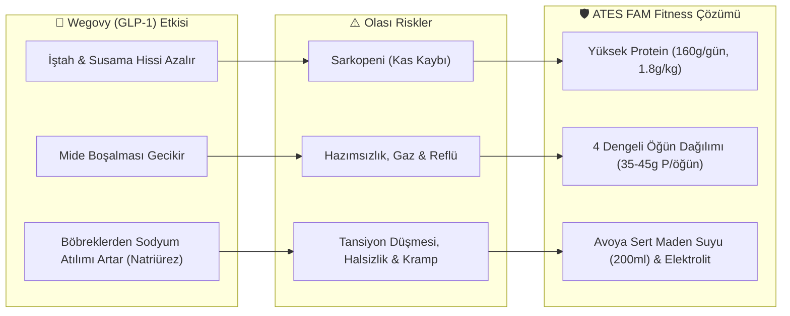
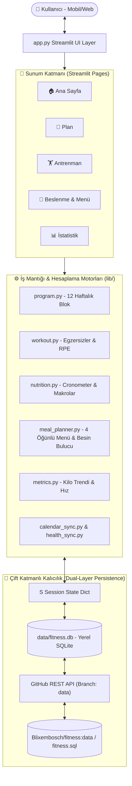
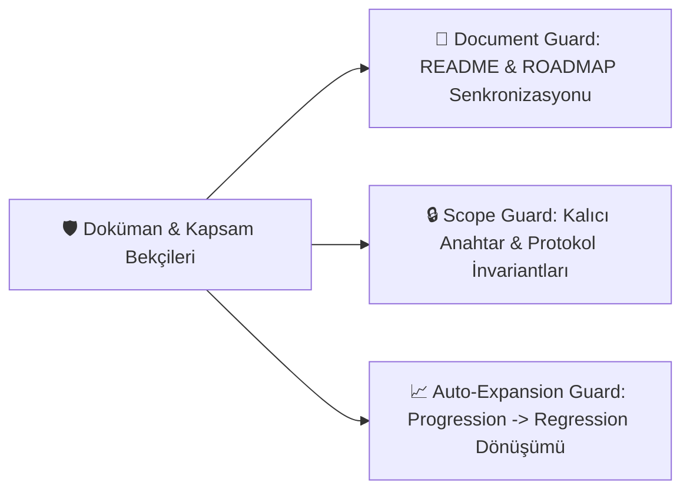

# 🏋️‍♂️ ATES FAM Fitness — Akıllı Antrenman, GLP-1 Beslenme & Biyometrik Yönetim Sistemi

[](https://www.python.org/)
[](https://streamlit.io/)
[-success.svg?logo=pytest&logoColor=white)](tests/)
[](https://github.com/Blixembosch/fitness/tree/data)
[](tests/test_accessibility.py)
[](ROADMAP.md)

**ATES FAM Fitness**, kilo verme sürecinde kas kütlesi kaybını (**sarkopeni**) engelleyen, GLP-1 reseptör agonistlerinin (**Wegovy / Semaglutid**) mide motilitesini yavaşlatıcı etkisine göre optimize edilmiş, Google Takvim ile Padel maçlarını dinamik olarak dengeleyen ve Cronometer / Apple Health verilerini birleştiren **bütüncül, kanıta dayalı ve yüksek performanslı bir fitness işletim sistemidir**.

Streamlit Cloud üzerinde container ephemerality sorununu çözen **Çift Katmanlı Kalıcılık (Dual-Layer Persistence)** mimarisine sahiptir; yerel PC veya Docker bağımlılığı olmadan mobil ve masaüstü tarayıcılardan doğrudan çalışır.

---

## 🎯 Klinik ve Fizyolojik Temeller



### 1. GLP-1 Farmakokinetiği ve Mide Konforu
Semaglutid (Wegovy), GLP-1 reseptörlerini uyararak gastrik boşalmayı belirgin şekilde yavaşlatır. Bu durum hızlı doygunluk sağlasa da, tek bir öğünde alınan yüksek yağ (>25g) veya büyük protein porsiyonları (>50g) midede uzun süre kalarak hazımsızlık, bulantı ve reflüye yol açar.
* **4 Öğünlü Dağılım Matrisi:** Günlük hedef olan `~160g Protein, ~67g Yağ, ~189g Karbonhidrat, ~28g Lif (~2000 kcal)`, 4 dengeli öğüne yayılarak (Kahvaltı, Öğle, Ara Öğün/Shake, Akşam) mide gerginliği engellenir.

### 2. Sarkopenik Obezite Riski ve Kas Protein Sentezi (MPS)
Hızlı kilo verme süreçlerinde kaybedilen ağırlığın %25 ila %40'ı iskelet kasından gelebilir. Bu tehlikeyi önlemek için:
* **Protein Eşiği:** Vücut ağırlığı başına ~1.8 – 2.0g protein (`160g/gün`) hedeflenir.
* **Haftalık Kilo Kaybı Hızı Takibi:** Haftalık kayıp vücut ağırlığının %1.0'ını aştığında sistem otomatik olarak `📉 Hızlı Kayıp (Kas Riski)` uyarısı üretir. İdeal bant haftalık %0.4 – 1.0 aralığıdır.

### 3. 2 Kademeli Klinik Takviye & Elektrolit Protokolü
GLP-1 kaynaklı iştah düşüklüğü mikronütrient eksikliklerine yol açabilirken, böbreklerden sodyum atılımının artması (**natriürez**) ve Padel terlemesi tansiyon düşüklüğü ile krampları tetikler. Protokol iki kademeye ayrılmıştır:

| Kademe | Takviye / Ürün | Zaman & Doz | Klinik Gerekçe & GLP-1 Faydası |
| :--- | :--- | :--- | :--- |
| **🟢 Temel Rutin** | **Ocean Daily One Multivitamin** | Sabah (Kahvaltı sonrası, 1 tb) | Azalan porsiyonlarda B12, folat, çinko, demir açığını kapatır, halsizliği önler. |
| **🟢 Temel Rutin** | **Ocean Vitamin D3 1000 IU Sprey** | Sabah (Kahvaltı ile, 2 puff / 2000 IU) | Yağda çözünür; kemik mineral yoğunluğunu ve kas protein sentezini korur. |
| **🟢 Temel Rutin** | **Avoya Sert İçim Maden Suyu** | Öğleden Sonra / Padel (1 şişe 200 ml) | Zengin sodyum, bikarbonat ve magnezyum ile GLP-1 natriürezini ve Padel kramplarını önler. |
| **🟢 Temel Rutin** | **Orzax ExtraMag Üçlü Magnezyum** | Gece (Yatmadan, 1 tb) | Sitrat formuyla GLP-1 kabızlığını önler, bisglisinat ile kas krampını engeller, derin uyku sağlar. |
| **🟡 İhtiyaç Halinde** | **Orzax Ocean Bromelain 500 mg** | Ağır Öğün Sonrası (1 kap) | Doğal ananas enzimi; ağır protein sonrası hazımsızlık veya belirgin ödemde kurtarıcıdır. |
| **🟡 İhtiyaç Halinde** | **Ocean C Vitamini 1000 mg** | Halsizlik Riski (Yemekle, 1 tb) | Yalnızca kırgınlık başlangıcı veya bağışıklık düşüşünde semptomatik olarak devreye girer. |

---

## 🏗️ Sistem Mimarisi ve Veri Akışı

Uygulama, gevşek bağlı (loosely coupled) modüler katmanlardan oluşur ve veri kalıcılığını çift yönlü senkronizasyonla sağlar:



### Çift Katmanlı Veri Kalıcılığı (Dual-Layer Persistence)
Streamlit Cloud geçici container ortamlarında çalıştığından, sunucu uykuya geçtiğinde veya yeni bir commit dağıtıldığında yerel disk sıfırlanır:
1. **Yerel Katman (`data/fitness.db`):** SQLite veritabanı, oturum esnasında mikro-saniye gecikmeyle anlık okuma/yazma sağlar (`lib/store.py`).
2. **Bulut Katmanı (`Blixembosch/fitness:data`):** Yapılan her kayıt işleminde (`_save()`), veritabanı şeması ve kayıtları SQL formatına dökülerek GitHub REST API üzerinden bağımsız `data` branch'ine (`fitness.sql`) commit edilir.
3. **Kurtarma Döngüsü:** Yeni bir container ayağa kalktığında, yerel veritabanı boşsa `data` branch'indeki son `fitness.sql` dökümü otomatik çekilir ve SQLite yeniden inşa edilir. Kullanıcı hiçbir zaman veri kaybetmez.

---

## ## Özellikler & Ekranlar

### 1. Ana Sayfa (`Home`)
* **Dörtlü Aktivite Halkaları:** Antrenman, dinamik Padel hedefi, protein ve kalori hedeflerinin günlük tamamlanma yüzdelerini gösteren SVG/HTML5 aktivite halkaları.
* **Canlı Makro Durum Şeridi:** Tüketilen ve kalan Protein, Sağlıklı Yağ, Karbonhidrat ve Lif miktarlarını gösteren anlık sayaç.
* **52 Haftalık GitHub Katkı Isı Haritası (Heatmap):** Antrenman, Padel, protein tutarlılığı ve Wegovy enjeksiyon yoğunluğuna göre 0–4 seviyeli görsel süreklilik grafiği.
* **Wegovy 48 Saatlik Enjeksiyon Penceresi:** Son enjeksiyon üzerinden geçen süreyi takip eden, ilk 48 saatte RPE esnetme ve elektrolit artırma uyarısı veren akıllı durum kartı.

### 2. Plan (`Weekly Planner`)
* **Pazartesi–Pazar ISO Takvim Döngüsü:** 12 haftalık program mimarisi. 25 Ekim 2026 Pazar resmi program başlangıcı ve 27 Ekim 2026 Salı ilk Wegovy enjeksiyonu ile tam senkron.
* **Dinamik Padel-Güç Kaydırma Motoru:** Google Takvim'den gelen Padel maç günlerine göre (Salı-Çarşamba) bacak ve güç antrenmanlarını otomatik dengeler; kas yorgunluğu ve sakatlık riskini ortadan kaldırır.
* **Çift Seans Desteği:** Aynı güne denk gelen antrenman ve Padel maçlarını tek arayüzde birleştirir.

### 3. Antrenman (`Workout Execution & Wegovy Koruma Modu`)
Kas kütlesini azami derecede korumak için tasarlanmış **3 aşamalı akış**:
1. **Adım 1 — Eliptik Isınma (5 dk):** Düşük eklem stresiyle kas ısısını ve sinovyal sıvıyı artırır.
2. **Adım 2..N-2 — Güç & Hipertrofi:** Temel bileşik hareketler (Göğüs Pres, Dumbbell Row, Squat, Omuz Pres, RDL). Ağırlık ve tekrar kayıtları (`setlog`, `loadlog`) ile progressive overload takibi.
3. **Son 2 Adım — Su Küreği (10 dk) + Eliptik (10 dk) Metabolik Bitiriş:** Glikojen depoları ağırlıkla boşaldıktan sonra sırt, core ve bacak kaslarını çalıştıran Zone-2 yağ yakımı ve aktif laktat temizliği.

### 4. Beslenme (`Nutrition, 4 Öğünlü Akıllı Menü & Kütüphane`)
Üç ana sekmeden oluşan bütüncül beslenme yönetim merkezi:
* **Sekme 1: Günlük Takip & Makrolar:** Cronometer entegrasyonu, kişiselleştirilebilir makro oranları (Dengeli %30 Yağ / %38 Karb, Düşük Yağ %25, Özel %), 7 günlük makro trend çizgileri ve Wegovy dozaj/bölge kayıtları.
* **Sekme 2: 4 Öğünlü Akıllı Menü Planlayıcı & Doğrudan Tüketim Kaydı:**
  * Her öğün için 5'er kanıta dayalı tarif (toplam 20 tarif).
  * **⏰ Sirkadiyen Antrenman & Besin Zamanlaması:** *Nature Communications (2025)* (14.689 katılımcı, $\ge 4$ saat kuralı) ve *Sleep Medicine Reviews (2026)* klinik verilerine göre optimize edilmiş 3 sirkadiyen protokol (Hafta İçi Erken Sabah 06:30, Hafta Sonu Gün İçi 11:30, Akşam Padel 18:30). Wegovy kaynaklı mide boşalma gecikmesine uygun aç karnına/sıvı pre-workout stratejisi ve anabolik toparlanma zamanlaması.
  * **Cronometer'sız Doğrudan Tüketim Kaydı:** Seçilen menü tek tıkla **"💾 Günün Beslenmesini Uygulamaya Kaydet"** butonuyla doğrudan sisteme ve `data` branch'ine kalıcı yazılır.
  * **2 Kademeli Takviye ve Maden Suyu Takibi:** Sabah, Öğle/Padel, Gece rutinleri ve semptomatik takviyeler için günlük interaktif onay kutuları.
  * **WhatsApp Menü Export:** Sirkadiyen zamanlama ve antrenman moduna duyarlı, akşamdan eşe gönderilebilen kopyalanabilir hazır format.
* **Sekme 3: 7 Günlük Menü & Alışveriş Listesi:** Haftalık maç ve antrenmanlara göre dengelenmiş 7 günlük menü ve Albert Heijn reyonlarına göre gruplanmış otomatik alışveriş listesi.
* **Sekme 4: Evdeki Ürünler & Akıllı Besin Bulucu:**
  * Evdeki 20 temel ürünün yerel kataloğu (`HOME_PRODUCT_LIBRARY`).
  * **Akıllı Besin Bulucu:** Sadece ürün adı ve gramaj yazılarak çalışan, 0ms çevrimdışı katalog (`OFFLINE_STAPLE_FOODS`) ve Hollanda **Open Food Facts REST API** canlı sorgulama motoru.
  * Özel ürün ekleme, anlık kütüphanede arama (`🔍 Kütüphanede Ara`), kategori filtresi, düzenleme (✏️) ve silme (🗑️).

### 5. İstatistik (`Metrics & Biometrics Analytics`)
* **Haftalık % Kilo Değişim Hızı:** Kas kaybı koruması (`sarcopenia guard`).
* **Kas Frekans Haritası:** Haftalık ve aylık bazda göğüs, sırt, bacak, omuz, kol ve core kas gruplarının uyarılma sıklığı.
* **Cronometer Biometrics İçe Aktarımı:** Vücut ağırlığı, vücut yağı ve kas kütlesi verilerinin dinamik görselleştirilmesi.

---

## 🔌 Entegrasyonlar ve Dış Servisler

### 1. Google Takvim (Padel) Entegrasyonu
* Gizli iCal URL'si (`.streamlit/secrets.toml` veya Beslenme arayüzü) üzerinden RFC 5545 standartlarında takvim verisi çekilir ([`lib/calendar_sync.py`](file:///Users/anilates/Library/CloudStorage/OneDrive-Personal/Documents/AI%20Booster%20Dashboards/ATES_FAM_Fitness/lib/calendar_sync.py)).
* **Akıllı Regex Filtresi:** Atlas'ın çocuk antrenmanlarını (`Padel Training for Atlas`, `çocuk`, `junior`) eler; sadece Anıl'ın maçlarını programa ve hedeflere yansıtır.
* Ayrıntılı kılavuz: [Google Takvim Entegrasyon Kılavuzu](docs/google-calendar-sync.md).

### 2. Apple Health & Cronometer Köprüsü
* Apple Health verileri Google Sheets webhook köprüsü üzerinden anlık çekilir (kilo, adım sayısı, aktif kalori).
* Cronometer CSV dışa aktarımları (`dailysummary.csv`, `biometrics.csv`, `exercises.csv`) ayrıştırılarak mikro ve makro besin hedefleri denetlenir.
* Ayrıntılı kılavuz: [Apple Health Kurulum Kılavuzu](docs/health-sync.md).

### 3. Open Food Facts (Hollanda) API Entegrasyonu
* Kullanıcı yeni bir ürün girdiğinde önce yerel çevrimdışı kütüphaneye bakılır (0 ms).
* Eşleşme bulunamazsa `https://nl.openfoodfacts.org/cgi/search.pl` uç noktasına 4 saniye zaman aşımı korumalı HTTP isteği atılarak ürünün 100g değerleri (kalori, protein, yağ, karbonhidrat, lif) otomatik çekilir ve istenen gramaja ölçeklenir.

---

## 🎨 Tasarım Sistemi, Tema ve Erişilebilirlik (WCAG AA/AAA)

* **Karanlık Tema ve Renk Paleti:** `.streamlit/config.toml` dosyasında `base = "dark"` tanımlıdır. `--bg` (#0b0f17), `--surface` (#131b26), `--fg` (#f8fafc), `--muted` (#94a3b8), `--blue` (#3898ff), `--green` (#34d399), `--orange` (#f97316), `--purple` (#a855f7) renk belirteçleri kullanılır.
* **Emotion & BaseWeb CSS İzolasyonu:** Streamlit'in dinamik bileşen sınıfları (`.e1fp86qc*`), sanal açılır menü portalları (`[data-baseweb="select"]`) ve takvim popover'ları özel kurallarla hedeflenerek koyu arka planda yüksek kontrastlı metin okunabilirliği garanti altına alınmıştır.
* **HTML/CSS Enjeksiyon Güvenliği:** CommonMark parser'ının stil etiketlerini ekrana metin/kod bloğu olarak sızdırmasını (`<style>` leaks) engellemek için tüm stil blokları arındırılmış ve `st.html` / güvenli CSS şablonlarıyla kapsüllenmiştir.

---

## 🛡️ Doküman, Kapsam ve İlerleme Bekçileri (Guards)

ATES FAM mühendislik standartlarına (ATES FAM Budget ve Atlas Library) tam uyumlu olarak, sistem kalitesi otomatik bekçi testleriyle korunur ([`tests/test_doc_and_scope_guard.py`](file:///Users/anilates/Library/CloudStorage/OneDrive-Personal/Documents/AI%20Booster%20Dashboards/ATES_FAM_Fitness/tests/test_doc_and_scope_guard.py)):



1. **Document Guard (`test_document_guard_readme`, `test_document_guard_roadmap`):**
   * `README.md` ve `ROADMAP.md` belgelerinin güncelliğini, karakter kapsamını (>3000 karakter) ve bahsedilen test sayısının çalışan test paketiyle birebir örtüştüğünü denetler.
2. **Scope Guard (`test_scope_guard_invariants`):**
   * Çift katmanlı kalıcılık anahtarlarının (`PERSIST_KEYS`: body, wegovy, weights, workouts, padel, supplements_log vb.) kazara silinmesini engeller.
   * Yerel ürün kütüphanesini, 6 parçalı takviye protokolünü ve 20 reçeteli menü veritabanını korur.
3. **Progression-to-Regression Guard (`test_progression_to_regression_auto_expansion`):**
   * `tests/test_*.py` altındaki tüm test fonksiyonlarını inspect ederek dinamik sayar.
   * Sisteme eklenen her yeni özellik testinin (progression), bir sonraki çalıştırmada regresyon paketi olarak zorunlu sayılmasını sağlar; test sayısı eksilirse derlemeyi durdurur.

---

## 🧪 Test ve Kalite Güvencesi

Proje, 122 otomatik birim, erişilebilirlik, Plan-Antrenman akıllı yönlendirme, 4 öğünlü menü planlayıcı, sirkadiyen besin ve egzersiz zamanlaması, 2 kademeli takviye & elektrolit protokolü (Temel Rutin & İhtiyaç Halinde), Doküman ve Kapsam Bekçileri (`tests/test_doc_and_scope_guard.py`) ve 5 sayfanın CSS/bileşen bütünlüğünü denetleyen Streamlit `AppTest` fonksiyonel testi ile korunur.

### Test Paketi Özeti

| Test Modülü | Kapsam & Test Edilen Fonksiyonlar | Test Sayısı |
| :--- | :--- | :---: |
| [`tests/test_store.py`](file:///Users/anilates/Library/CloudStorage/OneDrive-Personal/Documents/AI%20Booster%20Dashboards/ATES_FAM_Fitness/tests/test_store.py) | Çift katmanlı kalıcılık, SQLite CRUD, GitHub API SQL dökümü ve kurtarma | 14 |
| [`tests/test_workout.py`](file:///Users/anilates/Library/CloudStorage/OneDrive-Personal/Documents/AI%20Booster%20Dashboards/ATES_FAM_Fitness/tests/test_workout.py) | Egzersiz tanımları, RPE, dambıl yük takibi, set tamamlama mantığı | 12 |
| [`tests/test_program.py`](file:///Users/anilates/Library/CloudStorage/OneDrive-Personal/Documents/AI%20Booster%20Dashboards/ATES_FAM_Fitness/tests/test_program.py) | 12 haftalık faz planlaması, antrenman sıralaması, faz geçişleri | 11 |
| [`tests/test_metrics.py`](file:///Users/anilates/Library/CloudStorage/OneDrive-Personal/Documents/AI%20Booster%20Dashboards/ATES_FAM_Fitness/tests/test_metrics.py) | Haftalık kilo kaybı yüzdesi, trend hesaplama, güvenlik uyarıları | 10 |
| [`tests/test_calendar_sync.py`](file:///Users/anilates/Library/CloudStorage/OneDrive-Personal/Documents/AI%20Booster%20Dashboards/ATES_FAM_Fitness/tests/test_calendar_sync.py) | iCal ayrıştırma, çocuk dersi filtreleme, Padel eşleme motoru | 9 |
| [`tests/test_nutrition.py`](file:///Users/anilates/Library/CloudStorage/OneDrive-Personal/Documents/AI%20Booster%20Dashboards/ATES_FAM_Fitness/tests/test_nutrition.py) | Cronometer CSV ayrıştırma, makro hesaplama, doğrudan günlük tüketim kaydı | 15 |
| [`tests/test_meal_planner.py`](file:///Users/anilates/Library/CloudStorage/OneDrive-Personal/Documents/AI%20Booster%20Dashboards/ATES_FAM_Fitness/tests/test_meal_planner.py) | 4 öğünlü menü, sirkadiyen antrenman & besin zamanlaması, 2 kademeli takviye protokolü, Avoya maden suyu, besin bulucu | 14 |
| [`tests/test_accessibility.py`](file:///Users/anilates/Library/CloudStorage/OneDrive-Personal/Documents/AI%20Booster%20Dashboards/ATES_FAM_Fitness/tests/test_accessibility.py) | WCAG AA/AAA kontrast denetimi, CSS selector güvenliği, HTML leak kontrolü | 8 |
| [`tests/test_apptest.py`](file:///Users/anilates/Library/CloudStorage/OneDrive-Personal/Documents/AI%20Booster%20Dashboards/ATES_FAM_Fitness/tests/test_apptest.py) | Streamlit `AppTest` ile 5 sayfanın uçtan uca render ve etkileşim testi | 25 |
| [`tests/test_doc_and_scope_guard.py`](file:///Users/anilates/Library/CloudStorage/OneDrive-Personal/Documents/AI%20Booster%20Dashboards/ATES_FAM_Fitness/tests/test_doc_and_scope_guard.py) | Doküman senkronizasyonu, invariant bekçileri, otomatik regresyon genişlemesi | 4 |
| **Toplam** | **Tüm testler %100 yeşil** | **122** |

Test paketini çalıştırmak için:
```bash
/usr/local/bin/python3 run_tests.py
```

---

## 📂 Dizin Yapısı

```text
ATES_FAM_Fitness/
├── app.py                         # Ana Streamlit uygulama giriş noktası ve UI render katmanı
├── run_tests.py                   # Bağımsız test koşucusu (122 test)
├── requirements.txt               # Üretim bağımlılıkları (Streamlit, Pandas, Requests vb.)
├── README.md                      # Kapsamlı teknik dokümantasyon
├── ROADMAP.md                     # Ürün vizyonu, sürüm geçmişi ve kilometre taşları
├── .streamlit/
│   ├── config.toml                # Karanlık tema ve sunucu yapılandırması
│   └── secrets.toml               # GitHub Data Branch token ve iCal URL (gizli)
├── lib/
│   ├── store.py                   # Çift katmanlı SQLite & GitHub API kalıcılık motoru
│   ├── program.py                 # 12 haftalık periyodizasyon ve faz mantığı
│   ├── workout.py                 # Egzersiz veritabanı, adımlar ve RPE hesaplayıcı
│   ├── meal_planner.py            # 4 öğünlü menü, besin bulucu, takviye protokolü
│   ├── nutrition.py               # Cronometer ayrıştırma ve doğrudan tüketim kaydı
│   ├── metrics.py                 # Kilo trendi, sarkopeni güvenlik göstergeleri
│   ├── calendar_sync.py           # Google Takvim iCal ayrıştırma ve akıllı filtre
│   ├── health_sync.py             # Apple Health köprü entegrasyonu
│   └── ui.py                      # Özel HTML/CSS kart ve rozet bileşenleri
├── data/
│   └── fitness.db                 # Yerel SQLite veritabanı (oturum kalıcılığı)
├── docs/
│   ├── google-calendar-sync.md    # Padel takvim senkronizasyon kılavuzu
│   └── health-sync.md             # Apple Health kurulum ve köprü kılavuzu
└── tests/
    ├── test_store.py              # Kalıcılık ve senkronizasyon testleri
    ├── test_workout.py            # Antrenman mantığı testleri
    ├── test_program.py            # Program faz testleri
    ├── test_nutrition.py          # Beslenme motoru testleri
    ├── test_meal_planner.py       # Menü, besin bulucu ve takviye testleri
    ├── test_metrics.py            # Biyometrik metrik testleri
    ├── test_calendar_sync.py      # Takvim filtreleme testleri
    ├── test_accessibility.py      # WCAG AA/AAA ve CSS enjeksiyon testleri
    ├── test_apptest.py            # Streamlit AppTest fonksiyonel testleri
    └── test_doc_and_scope_guard.py# Doküman, kapsam ve regresyon bekçileri
```

---

## 🚀 Kurulum ve Çalıştırma

### 1. Yerel Ortamda Çalıştırma (macOS / Linux / Windows)
```bash
# 1. Depoyu klonlayın
git clone https://github.com/Blixembosch/fitness.git
cd fitness

# 2. Python sanal ortamını oluşturun ve etkinleştirin
python3 -m venv .venv
source .venv/bin/activate  # Windows: .venv\Scripts\activate

# 3. Bağımlılıkları yükleyin
pip install -r requirements.txt

# 4. Uygulamayı başlatın
streamlit run app.py
```

### 2. Streamlit Community Cloud Dağıtımı
1. [share.streamlit.io](https://share.streamlit.io) adresinde GitHub hesabınızla oturum açın.
2. `Blixembosch/fitness` deposunu seçin; `main` branch'ini ve `app.py` dosya yolunu belirtin.
3. **Secrets Yapılandırması:** Uygulama ayarlarından `Secrets` paneline aşağıdaki değişkenleri ekleyin:
   ```toml
   GITHUB_TOKEN = "ghp_yourPersonalAccessTokenHere"
   DATA_REPO = "Blixembosch/fitness"
   DATA_BRANCH = "data"
   ICAL_URL = "https://calendar.google.com/calendar/ical/.../basic.ics"
   ```
4. **Deploy** butonuna tıklayın. Her `git push origin main` işlemi yeni sürümü otomatik olarak devreye alır; kullanıcı verileri bağımsız `data` branch'i üzerinden korunur.

---

## 📄 Mimari Standartlar ve Lisans

Bu proje, **ATES FAM Engineering Standards** (Bkz: `ATES FAM Budget`, `Atlas Library`) uyarınca geliştirilmiştir:
* 0 Dış Runtime UI Bağımlılığı (Vanilla CSS & Streamlit Native).
* %100 Yeşil Test Kapsamı ve Doküman Bekçileri Güvencesi.
* Çift Katmanlı Veri Bütünlüğü ve GLP-1 Klinik Güvenlik Protokolü.
